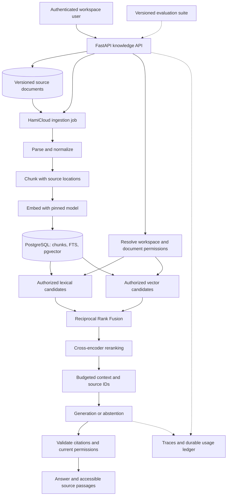

# HamiKnowledge — Production RAG Platform with a Bounded Agent

## Engineering roadmap (standalone)

**Prepared for:** hami9
**Planning date:** September 12, 2026
**Document status:** Proposed architecture and implementation plan
**Language:** English
**Working name:** HamiKnowledge; naming availability has not been checked.
**Companion project:** HamiCloud (separate roadmap, separate repository). HamiKnowledge is deployed as a tenant application on it.

> Build this after HamiCloud reaches v1. It demonstrates measurable AI application engineering: ingestion, retrieval experiments, grounded answers, evaluation, tracing and budgets.

All milestones below are planned work. Quality and performance numbers are initial acceptance targets, not measured results. This document does not claim that the platform already exists or has passed production validation.

## Contents

1. [Goal and portfolio fit](#goal-and-portfolio-fit)
2. [Product definition](#product-definition)
3. [AI architecture and product contracts](#ai-architecture-and-product-contracts)
4. [MVP and phased roadmap](#mvp-and-phased-roadmap)
5. [AI evaluation and benchmarks](#ai-evaluation-and-benchmarks)
6. [Repository and README checklists](#repository-and-readme-checklists)
7. [Portfolio and demo checklists](#portfolio-and-demo-checklists)
8. [Definition of done and execution plan](#definition-of-done-and-execution-plan)

## Goal and portfolio fit

### Goal and reason to include it

Build a multi-user knowledge workspace that ingests technical documents and produces answers with traceable citations. Compare retrieval strategies, evaluate answer quality, and expose latency and cost per request. Add a small read-only agent only after the retrieval baseline works.

**Product promise:** "Ask a question about your workspace's documents, inspect the supporting passages, and see the quality and cost of the answer."

This should be a separate repository and portfolio case study, deployed as a HamiCloud application. It reuses infrastructure experience while keeping AI evaluation independently reproducible.

### What this project proves

HamiKnowledge demonstrates **AI application and retrieval engineering**: data pipelines, search, evaluation, inference integration, and operations. It does not by itself establish model-training expertise. If training becomes a career requirement, a later, separately scoped reranker fine-tuning experiment can add evidence through training data, held-out evaluation, and a model card. That extension is not required to finish this project.

| Evidence to add | What a reviewer should be able to inspect |
| --- | --- |
| Production AI application engineering | Ingestion, retrieval experiments, grounded answers, evals, tracing and budgets |
| Multi-tenant data handling | Workspace ACLs, deletion/revocation lifecycle, cache isolation, trace privacy |
| Measured decision-making | B0–B3 ablations, per-language results, cost per grounded answer, published negative results |
| Product completion | A usable dashboard, reproducible quickstart, evaluation report |

### How the existing work can connect

- Use experience from Astolfo to inform conversational UX. Keep retrieval, evaluation, and cost accounting independently testable.
- Reuse HamiCloud's OIDC and telemetry infrastructure without sharing all credentials.

### Prerequisite

HamiCloud v1 (M6) provides the asynchronous execution path used for ingestion. A standalone development setup without HamiCloud must still exist so that the quickstart and evaluation are reproducible by an independent developer. Do not start this implementation while HamiCloud work is still open unless that pause is a deliberate decision.

## Product definition

### Focused use case

Start with public or self-authored engineering documentation: deployment guides, runbooks, API documentation and architecture notes. Support English and Persian technical questions, including mixed-language terminology. Use content whose license permits the intended demo and redistribution.

Example questions:

- "How do I recover a failed deployment without losing its logs?"
- "Which settings control retry count and execution timeout?"
- A Persian question referring to English configuration names.
- A deliberately unanswerable question that should produce an explicit abstention.

### Scope

**MVP:** Authenticated workspaces, Markdown/text/text-based PDF ingestion, source versioning, lexical and vector search, hybrid retrieval, cross-encoder reranking, cited answers, evaluation runner, traces and usage accounting.

**v1:** Add deletion/reindex guarantees, concurrent multi-user tests, budget enforcement, quality regression gates, and a bounded read-only tool loop.

**Outside v1:** Training a foundation model, OCR, arbitrary web crawling, dozens of connectors, audio/video ingestion, autonomous shell execution, an open-ended multi-agent framework, and billing.

### Technology choices

| Layer | Choice | Purpose |
| --- | --- | --- |
| API and pipeline | Python, FastAPI, typed stage interfaces | Ingestion orchestration, retrieval, answer generation and evaluation |
| Storage | PostgreSQL with pgvector and native full-text search | Document metadata, ACLs, chunks, vectors, runs and usage ledger |
| Documents | S3-compatible storage | Immutable source versions and authorized previews |
| Retrieval | Lexical full-text ranking + vector similarity + Reciprocal Rank Fusion | Reproducible hybrid search with independently testable branches |
| Reranking | A pinned multilingual cross-encoder through Sentence Transformers | Improve ordering of a small candidate set; evaluate language coverage |
| Embeddings | One pinned multilingual model initially | Record model revision, vector dimension and normalization settings |
| Generation | One configurable model provider plus an offline test adapter | Real inference with repeatable contract tests that do not spend tokens |
| Async processing | HamiCloud finite jobs | Parse/chunk/embed/index bounded document batches |
| Cache and quotas | Redis plus PostgreSQL budget ledger | Tenant-aware retrieval caching and atomic usage reservations |
| UI | Small React dashboard | Documents, ingestion state, conversations, citations and usage |
| Evaluation | Versioned dataset, pytest and a dedicated evaluation runner | Retrieval metrics, groundedness checks, latency and cost comparison |
| Telemetry | OpenTelemetry with the shared collection backend | Stage timing and end-to-end request investigation |

Select embedding and reranker models in R0 using a small development set, CPU/RAM limits, language support and license review. Pin the selected revisions; do not allow silent model replacement. Sentence Transformers supports embedding and reranking workflows, but model-specific suitability still needs evaluation. [Sentence Transformers](https://github.com/huggingface/sentence-transformers).

## AI architecture and product contracts

### Data and query paths



### Ingestion contract

1. Validate file type, MIME/content consistency, size, page count and workspace quota. Begin with a 10 MB/file limit and text-based PDFs only.
2. Store an immutable source version with workspace ID, content hash, filename, license/source information and uploader.
3. Submit an ingestion job with a stable document-version key. Repeated uploads of the same content should not repeatedly charge for embedding within that workspace/version policy.
4. Parse within an isolated, resource-limited task. Preserve page/heading/character locations; reject unsupported scanned PDFs with an actionable UI message.
5. Normalize Unicode and Persian/Arabic letter variants for search while retaining the original text for citations. Test half-spaces and mixed Latin technical identifiers.
6. Begin with approximately 500-token chunks and 75-token overlap, respecting headings when possible. These are tunable development parameters, not universal optimums.
7. Store chunk IDs, offsets, source version, language and permissions with each embedding. Batch requests and retry transient provider failures within a fixed budget.
8. Activate the new index version only after all required stages succeed. Keep the previous valid version usable during a failed reindex.
9. Expose `UPLOADED`, `PARSING`, `EMBEDDING`, `INDEXING`, `READY`, `FAILED` and `DELETING` states with progress and retry controls.

For deletion or access revocation, immediately exclude affected content from queries and previews, invalidate scoped caches, and cancel or supersede related indexing work. Delete source objects, chunks and vectors asynchronously with an auditable completion record. Recheck permissions before final answer delivery and when opening citations. Define how retained conversation text is removed or redacted; hiding the original document alone does not remove copies in past answers.

### Retrieval and generation contract

- Implement a lexical baseline with PostgreSQL full-text search and a vector-only baseline with pgvector. PostgreSQL native full-text ranking is not automatically BM25; label the method accurately. [PostgreSQL text search](https://www.postgresql.org/docs/current/textsearch-intro.html).
- Apply workspace and document authorization in both retrieval queries. Merge only authorized candidates; unauthorized text must never reach the reranker, model context, cache response or trace payload.
- Start with exact vector search at the small demo corpus size. If an approximate index is added, measure recall under restrictive ACL filters: filtering can reduce returned candidates. Tune or partition without weakening authorization. [pgvector filtering guidance](https://github.com/pgvector/pgvector#filtering).
- Retrieve up to 30 candidates from each branch, fuse ranks, deduplicate by chunk ID, rerank the best 20, and supply at most 5–8 passages within a fixed token budget. Evaluate these development defaults. pgvector documents combining vector and text search with rank fusion and reranking. [pgvector hybrid search](https://github.com/pgvector/pgvector#hybrid-search).
- Store retrieval and prompt configuration versions with every run. Changing embedding dimension/model requires a versioned reindex, not mixing incompatible vectors.
- Request source IDs for factual claims and validate that cited IDs exist in the retrieved context. Citation existence is a structural check; whether a citation supports a claim is evaluated separately.
- When evidence is insufficient or contradictory, say so and show relevant passages when available. Calibrate abstention policy on development data.
- Stream answers with a cancellation control. Recheck access during source assembly and before delivery; never trust a model to enforce tenant permissions.

### Bounded agent extension

After the evaluated RAG path is stable, permit only two read-only tools: `search_documents` and `get_document_excerpt`. Both enforce the current user's workspace and document permissions on the server.

Set a maximum of 3 tool calls, a 20-second request deadline, and a per-request token/cost ceiling. Stop on repeated identical calls, exhausted budget or deadline. Persist tool choices, arguments after redaction, execution timings and stop reasons.

Retrieved documents are untrusted data. Instructions inside them cannot change tool permissions, reveal secrets, select another workspace, or authorize external actions. Do not add shell execution, deployment tools, arbitrary URLs, or database-write tools to v1.

### Multi-user, privacy and cost requirements

| Requirement | Implementation contract |
| --- | --- |
| Workspace support | Owner/member/viewer roles, document ACLs, private conversations and authorized previews |
| Cache isolation | Include workspace, permission version, corpus version, model and retrieval settings in cache keys |
| Provider disclosure | Show which inference/embedding provider receives document content; public demo uses approved non-sensitive data |
| Trace privacy | Store IDs and timings by default; raw prompt/context capture is opt-in, redacted and retention-limited |
| Usage tracking | Record embedding input, generation input/output, reranking usage or compute time, retries and cancellations |
| Cost calculation | Versioned price table with currency and effective date; calculate usage by provider/model and distinguish estimate from reported usage |
| Budget enforcement | Atomically reserve a conservative upper bound before each external call; reconcile actual usage afterward |
| Unknown outcomes | Keep uncertain provider charges as pending/estimated; do not refund a reservation merely because the client disconnected |
| Idempotency | Deduplicate ingestion/run ledger writes; do not claim provider calls are exactly-once after ambiguous timeouts |

Expose request count, latency, tokens, estimated cost, reported usage when available, and remaining workspace budget. If running local models, report compute usage separately rather than assigning an invented token price.

### Integration with HamiCloud

Deploy the knowledge API/UI as HTTP applications. Package ingestion as a finite workload image that processes a bounded document batch. HamiKnowledge submits that job using a service identity scoped to its HamiCloud project, and passes only short-lived document-specific access credentials.

Poll or subscribe through the supported runtime API for job completion, then reconcile the document state. The runtime owns execution and retries; HamiKnowledge owns document versions, index validity and AI quality. This makes this project a practical test of HamiCloud's public interfaces.

Keep PostgreSQL roles/databases and data ownership separate even if both applications share one server. Reuse OIDC and telemetry infrastructure without sharing all credentials. Do not expose the HamiCloud control database directly to the AI application.

## MVP and phased roadmap

### MVP acceptance checklist

- [ ] A user signs in and uploads Markdown, text or a supported PDF.
- [ ] The user sees ingestion progress and actionable failure states.
- [ ] A ready document becomes searchable without restarting the service.
- [ ] The user asks a question and opens citations at the correct source location.
- [ ] Lexical, vector, hybrid and reranked retrieval can be evaluated from the same dataset/configuration framework.
- [ ] An unsupported question produces an explicit insufficient-evidence response.
- [ ] Another workspace cannot retrieve the document, conversation, preview, usage record or cached answer.
- [ ] Each query shows latency and usage/cost information.
- [ ] Evaluation results can be reproduced with recorded corpus/model/configuration versions.

### Phased roadmap

| Phase | Focused effort | Implementation scope | Milestone and exit evidence |
| --- | --- | --- | --- |
| R0 — Define evidence | 8–10 hours | Licensed corpus, task boundaries, dataset split, quality rubric, model/license selection and CPU feasibility check | **A0: Evaluation baseline defined.** Development data and frozen test manifest committed |
| R1 — Ingest and isolate | 14–18 hours | Auth, workspaces, uploads, parsing, chunks, source versions, ingestion jobs, lexical search and basic UI | **A1: Searchable workspace.** Two users ingest separate content; duplicates and failures behave predictably |
| R2 — Retrieve and cite | 14–20 hours | Embeddings, vector search, RRF hybrid retrieval, cross-encoder reranking, cited answers and abstention | **A2: RAG MVP candidate.** A question opens its supporting passage; all retrieval variants produce evaluation output |
| R3 — Evaluate and operate | 16–22 hours | Frozen eval run, ablations, latency/cost measurements, tracing, budgets and regression policy | **A3: Evaluated MVP.** Quality/cost report published; chosen default justified by evidence |
| R4 — Complete lifecycle and agent | 10–15 hours | Deletion/reindex/revocation, concurrent budget tests, injection tests and bounded read-only tools | **A4: Multi-user v1 candidate.** Revoked content is excluded; tool loop respects scope, limits and deadlines |
| R5 — Deploy and present | 8–10 hours | HamiCloud deployment, CI quality gates, clean quickstart, release notes, model/data documentation and demo | **A5: HamiKnowledge v1.0.** Definition of done and portfolio checklist pass |

Estimated effort: **70–95 focused hours**, or approximately **88–119 hours with 25% integration/learning allowance**. At 15 hours/week, plan **6–8 weeks after HamiCloud v1**. Avoid developing both full implementations at once.

## AI evaluation and benchmarks

### Evaluation dataset

Create an initial set of **200 reviewed questions**:

| Split | Size | Use |
| --- | --- | --- |
| Development | 60 | Tune chunking, fusion, candidate counts, prompts and abstention |
| Frozen quality test | 100 | 70 answerable and 30 unanswerable questions; final comparison and release checks |
| Adversarial/lifecycle | 40 | Document prompt injection, misleading citations, deleted content, ACL changes and tool misuse |

The frozen quality set should include approximately 30 English, 30 Persian and 40 mixed-language questions. Record the actual distribution and stratified results. Include short fact lookup, multi-passage synthesis, exact technical terms and ambiguous questions.

For each answerable item, store relevant passage IDs, allowed answer facts and a scoring rubric. Keep questions from the same source section or near-duplicate family in one split. The corpus remains available to retrieval; the test queries, relevance labels and answer rubrics must not be indexed or used for tuning.

Synthetic drafts can help create questions, but review their relevance labels and expected answers manually. Use domain data for the final claim; public suites such as [BEIR](https://github.com/beir-cellar/beir) are useful retrieval evaluation references, not substitutes for this application's own test set.

### Required ablation report

| Variant | Lexical | Vector | Fusion | Reranker | Purpose |
| --- | --- | --- | --- | --- | --- |
| B0 | Yes | No | No | No | Exact-term baseline |
| B1 | No | Yes | No | No | Semantic baseline |
| B2 | Yes | Yes | RRF | No | Measure hybrid retrieval contribution |
| B3 | Yes | Yes | RRF | Yes | Measure reranking quality and latency tradeoff |
| B4 | Best evaluated retrieval | As selected | As selected | As selected | Add bounded agent loop and measure whether it helps |

Use the same corpus, queries, generation model, answer budget and scoring rubric for relevant comparisons. Freeze configuration before the final test run. Report negative results: the more complex variant does not automatically become the production default.

### Metrics and initial targets

| Metric | Definition | Initial target |
| --- | --- | --- |
| Recall@10 | Fraction of labeled relevant passages retrieved in top 10, averaged over answerable questions | >= 0.85; publish per-language results |
| nDCG@10 | Ranking quality using the documented relevance grades | Aim for +0.05 absolute over the strongest single-branch baseline; measure paired uncertainty |
| Citation validity | Cited source IDs exist and are authorized | 100% in the release test suite |
| Citation support precision | Supported claim/citation pairs divided by evaluated pairs, using human review | >= 95% on a stratified sample of at least 50 answers |
| Grounded answer pass rate | Answers whose factual claims are supported by the available evidence under the rubric | >= 90% of reviewed answerable cases |
| Appropriate abstention | Unanswerable cases correctly declined | >= 90%, with false abstention <= 10% on answerable cases |
| Tenant isolation | Unauthorized text or metadata returned through any tested surface | Zero exposure in the test matrix; any confirmed exposure blocks release |
| Local retrieval latency | Query embedding + lexical/vector retrieval + fusion; 20,000 chunks, 5 concurrent users, warm model | p95 <= 1 second on a documented 8-vCPU/16-GB CPU profile |
| Reranking latency | Rerank up to 20 candidates, measured separately on the same profile | p95 <= 2 seconds; reduce candidate count or change model only through evaluated configuration |
| Answer completion | End-to-end query, up to 400 output tokens, fixed provider/model, 5 concurrent users | Initial target p95 <= 15 seconds; publish provider latency and errors separately |
| Ingestion correctness | Re-upload and job restart on the same source version | One active version, no duplicate indexed chunks, visible recovery state |
| Budget enforcement | 20 concurrent requests against a nearly exhausted workspace budget | No unreserved provider call; a clear budget-exhausted response |

Quality thresholds are project decisions to validate, not guarantees from the selected libraries. Report retrieval improvement with paired bootstrap confidence intervals, and raw counts for small pass/fail samples. A dataset of this size supports a portfolio experiment, not broad claims about all languages or domains.

Use an automated judge as supplementary feedback. Record its prompt/model version and calibrate against manual labels. It must not be the only evidence for citation support or groundedness.

### Performance, cost and regression protocol

- Benchmark on 500 licensed/self-authored documents producing approximately 20,000 chunks; record actual document lengths and count. Measure cold/warm model and cache conditions separately.
- Test 1, 5 and 10 concurrent users. Run a 10-minute steady query workload for each level and record queueing, cancellations, rate-limit responses and errors.
- Run a separate 100-document ingestion test with recorded total tokens. Report documents/minute, chunks/second, embedding latency and retry overhead.
- Compare B0–B3 on quality, p50/p95 latency, token usage, cost per answered query, and cost per grounded answer. Include failed/retried calls in spend totals.
- Record provider, model revision, measurement date, price-table version and cache hit ratio. Show estimated and provider-reported usage separately where available.
- Use deterministic adapters and a small fixed regression set on ordinary PRs. Run the full frozen suite for release candidates; run costly live-provider checks through a bounded CI workflow.
- Block on new isolation failures, invalid citations, missing accounting or significant documented quality regression. Investigate a nDCG drop > 0.03 or groundedness drop > 5 percentage points; do not blindly gate on one noisy live-model sample.
- If a complex variant fails to improve quality enough for its cost, keep the best measured baseline as default and publish the experiment. Hybrid and reranked paths must still be implemented and evaluated to satisfy this project's scope.

The AI benchmark profile excludes ingestion running concurrently unless the scenario explicitly says otherwise. Deployment on HamiCloud does not make resources free: publish both services' actual allocations when measuring them together.

## Repository and README checklists

### Suggested repository structure

These are proposed paths inside a future repository, not existing implementation files.

```text
hamiknowledge/
  apps/api/
  apps/web/
  ingestion/
  retrieval/
  generation/
  agent/
  evals/datasets/           # Development and controlled test manifests
  evals/reports/            # Comparisons, labels and measurement notes
  deploy/                   # Runtime manifests and standalone dev setup
  docs/                     # Model/data notes and operating procedures
  .github/workflows/
```

Avoid publishing copyrighted source documents or sensitive test data with the repository. Where redistribution is unavailable, publish a licensed substitute or a deterministic acquisition/build recipe and content hashes.

### README checklist

- [ ] A one-sentence product description and specific intended user.
- [ ] A short demo video/GIF near the top, with an accessible explanation.
- [ ] A working demo URL or clear local-demo instructions.
- [ ] Architecture diagram plus responsibility boundaries and key tradeoffs.
- [ ] Tested quickstart with prerequisites, exact commands, expected output and first user action.
- [ ] Supported OS/container environment and measured hardware requirements.
- [ ] Example configuration with placeholders, including how to obtain credentials safely.
- [ ] Current capabilities separated from future roadmap items.
- [ ] Test instructions and links to actual CI runs for the release.
- [ ] Evaluation results with environment, commit and reproduction steps.
- [ ] Security model, supported tenancy level and known limitations.
- [ ] Installation, upgrade, rollback, backup/restore and uninstall behavior.
- [ ] License, contribution guide, issue templates, changelog and security reporting instructions.
- [ ] A release/tag that someone else can install and reproduce.

### Additional HamiKnowledge README requirements

- [ ] Describe the corpus, license, language coverage and known parser limitations.
- [ ] Publish model revisions, licenses and index/retrieval/prompt configuration.
- [ ] Explain dataset splits and how test labels are kept out of retrieval/tuning.
- [ ] Include B0–B3 results and the reason for the default retrieval strategy.
- [ ] Define citation/groundedness metrics, judge limits and manual review procedure.
- [ ] Show usage/cost accounting, provider disclosure and workspace budget behavior.
- [ ] Document deletion, permission revocation, cache isolation and trace retention.
- [ ] Describe allowed agent tools and enforced step/time/budget limits.

## Portfolio and demo checklists

### Demo script — approximately 4 minutes

| Time | Demonstration | Evidence conveyed |
| --- | --- | --- |
| 0:00–0:50 | Upload a document and watch ingestion | Data lifecycle and asynchronous execution |
| 0:50–1:40 | Ask an English/Persian technical question and open citations | Retrieval, grounding and language coverage |
| 1:40–2:15 | Ask an unanswerable question | Honest abstention |
| 2:15–2:50 | Switch workspaces or revoke a document and query again | Enforced access boundaries |
| 2:50–3:30 | Compare retrieval variants and show trace/cost | Evaluation and operating visibility |
| 3:30–4:00 | Show a bounded tool call and stop reason | Controlled agent behavior |

Record failure experiments in a disposable environment. A demo should distinguish live actions from prerecorded evidence and label accelerated time where applicable.

### Website/GitHub portfolio checklist

- [ ] Add one focused case-study page for the project.
- [ ] Pin HamiKnowledge after publishing the evaluation report.
- [ ] Include three useful screenshots: the main flow, an abstention/revocation view, and measured results.
- [ ] Link code, release, demo, architecture, evaluation report and known limitations.
- [ ] Explain two difficult decisions and the alternatives considered.
- [ ] State personal contribution clearly, including reused components and external services.
- [ ] Make the demo understandable without requiring a reviewer to call internal APIs or inspect the database.
- [ ] Provide a limited demo account or read-only mode with clear expiry/reset behavior.
- [ ] Keep future work separate from delivered capabilities.

### Resume statement template

Replace bracketed fields only with measured facts after completion.

> Built a multi-user RAG platform with hybrid retrieval, reranking, source citations and cost accounting; evaluated [dataset size and languages], achieved [measured metric] against [baseline], and verified access isolation and document revocation through [test evidence].

## Definition of done and execution plan

### HamiKnowledge v1.0 completion gate

- [ ] A0–A5 have linked evidence and the entire upload-to-cited-answer path works.
- [ ] Lexical, vector, hybrid and reranked retrieval are implemented and compared.
- [ ] Frozen-set evaluation, manual review and per-language results are published.
- [ ] Citation validity and tenant isolation gates pass.
- [ ] Reindexing, deletion, permission revocation and cached answers obey the documented lifecycle.
- [ ] Ingestion and query retries/cancellations appear correctly in the usage ledger.
- [ ] Workspace budgets hold under concurrent requests.
- [ ] Agent tools obey server-side scope and step/time/budget limits.
- [ ] HamiCloud deployment and the independent developer quickstart both work.
- [ ] Model/data documentation, traces, measured cost/latency, CI results and demo are complete.

### How to close a milestone

Use an evidence record containing the milestone ID, commit SHA, environment, acceptance criteria, automated test links, manual demo results, measured outcomes and remaining limitations. A mock-only test cannot establish live provider behavior. Record each validation boundary explicitly.

If a required correctness or isolation gate fails, the milestone stays open. For quality and performance targets, either meet the target or make an explicit, dated scope/target revision with a measured rationale and rerun the evaluation. Do not mark unperformed checks as passed.

### First two weeks

Derived from R0 and the start of R1; adjust after the first measured week.

| Order | Concrete task | Finished artifact |
| --- | --- | --- |
| 1 | Create the HamiKnowledge repository and copy the selected scope into its README | README with current status, license and issue templates |
| 2 | Assemble the licensed corpus and record source/license/language for each document | Corpus manifest with content hashes |
| 3 | Write ADRs for retrieval strategy, index versioning, tenancy model and provider/cost accounting | Four concise design records |
| 4 | Define the 200-question split, relevance labels and scoring rubric | Development set plus a frozen, committed test manifest |
| 5 | Select and pin embedding/reranker model revisions after a CPU feasibility check | Model selection note with licenses, dimensions and measured local latency |
| 6 | Define document/chunk/ACL/run/usage tables and the evaluation runner interface | Migration plus a runner that produces an empty but valid report |
| 7 | Ship upload + parse + chunk + lexical search for one workspace | First end-to-end searchable document in the UI |

### Weekly working rhythm

Spend most implementation time completing one user-visible slice. Reserve a regular block for evaluation, evidence and documentation. At the end of each week, demonstrate what now works, record one unresolved risk, and choose the smallest next acceptance criterion.

Keep one owner per issue and one migration owner. If collaborators or coding agents are added later, assign bounded areas and make integration responsibility explicit before concurrent edits. This document does not require a multi-agent workflow.

### Total investment and stop rule

At approximately 15 hours/week, this roadmap is **88–119 hours**, or roughly **6–8 weeks**, including the stated allowance. Re-estimate after A1.

If time is limited, cut extra model providers, additional connectors and visual polish before cutting evaluation rigor, authorization, lifecycle correctness or the working product path. The bounded agent (R4) is the first feature to postpone; the ablation report is not.

**Stop adding features when the v1 completion gate passes.** Publish the release and its evidence, gather feedback from a small number of users, and create a new roadmap only for demonstrated needs.
